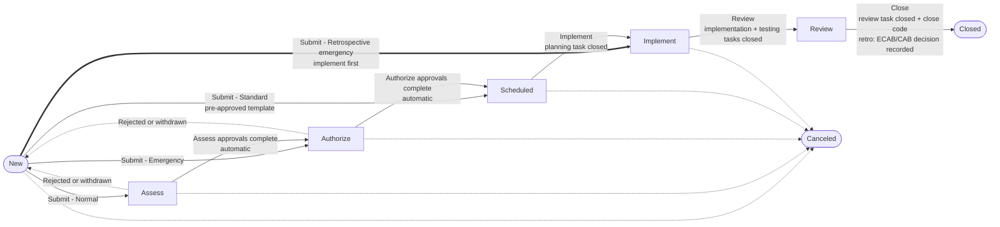

# VAICS CMS – Complete Guide

Version 2.1 (adds retrospective emergency changes) · Written from the actual code in `/workspace/CMS` (backend `app/engine.py`, `app/insights.py`, `app/models.py`, `app/routers/*`, frontend `src/`). Prepared for Krishna, VAICS.

**Live deployment (your PC):** frontend `http://192.168.50.87:5176`, backend API `http://192.168.50.87:8011/api/v1` (port 8011 because IMS PROD holds 8001). API docs at `http://192.168.50.87:8011/docs`. Demo logins all use password `Demo@123`.

---

## 1. Overview

VAICS CMS is a web-based IT **change management system**. It is a place where engineers raise a change ("I want to update the NAS firmware on Saturday"), the right people assess and approve it, the work is scheduled without clashing with other work, and the outcome is recorded and reviewed. It copies the proven **ServiceNow Change Management** model: the same seven states (New → Assess → Authorize → Scheduled → Implement → Review → Closed, plus Canceled), the same three change types (Standard, Normal, Emergency), change tasks, a risk questionnaire with a risk/impact matrix, policy-driven approvals, a CAB Workbench, a change schedule with blackout and maintenance windows, and a CMDB of configuration items. On top of this it adds a small number of modern features: AI-assisted plans, summaries and risk prediction (with a rules-based fallback when no AI key is set), automatic approval of low-risk work, a team Success Score, a DevOps pipeline API, Slack/Teams webhooks, a Kanban board, analytics and keyboard shortcuts. It is built on React 19 + Vite (frontend) and FastAPI + SQLAlchemy + Alembic (backend), with SQLite by default and PostgreSQL supported via `DATABASE_URL`.

---

## 2. Workflow

### 2.1 Diagram



### 2.2 ASCII version

```
 NORMAL:     New --submit--> Assess ==approvals==> Authorize ==approvals==> Scheduled --> Implement --> Review --> Closed
 EMERGENCY:  New --submit-------------------------> Authorize ==ECAB=======> Scheduled --> Implement --> Review --> Closed
 STANDARD:   New --submit (pre-approved template)------------------------> Scheduled --> Implement --> Review --> Closed
 RETRO EMERGENCY: New --submit (justification, optional verbal auth)-----------------> Implement --> Review ==ECAB/CAB retro decision==> Closed
                  (Review = "Retrospective Review (ECAB)": owner submits 7-part justification; reviewers accept /
                   accept with actions / request info (back to owner) / reject & escalate; closing blocked until decided)

   Assess / Authorize --(any rejection, or owner withdraws)--> New
   New, Assess, Authorize, Scheduled, Implement --(cancel, reason required)--> Canceled
   Review and Closed can NOT be canceled.

   --> = a person clicks the button      ==> = moves automatically when approvals are complete
```

### 2.3 Paths per change type (from `engine.PATHS`)

| Type | Path | What makes it different |
|---|---|---|
| **Normal** | New → Assess → Authorize → Scheduled → Implement → Review → Closed | Full path. Technical approval in Assess, management/CAB authorization in Authorize. |
| **Standard** | New → Scheduled → Implement → Review → Closed | Must be created from an active, pre-approved catalog **template**; skips Assess and Authorize. On submit, Approval is set to *approved*. |
| **Emergency** | New → Authorize → Scheduled → Implement → Review → Closed | Skips Assess; requires a **Justification**; authorized by ECAB; PIR notes mandatory at closure; maintenance windows are not enforced as a conflict. |
| **Emergency – retrospective** (box ticked on the form) | New → Implement → Review → Closed | Implemented **first**, no approvals before work. Requires Justification, CI and Assignment group; planned window defaults to now + 2 h if empty; plans optional. Optional *verbal authorization* recorded. Review is a mandatory **ECAB/CAB retrospective review** (§6.1); closing is blocked until the owner has submitted the justification and ECAB/CAB has decided. The retrospective replaces PIR notes. |

### 2.4 Each state

"Owner" = the requester of the change. "Assignee" = a user with role implementer, change manager or admin who is either the *Assigned to* person or a member of the change's *Assignment group*.

| State | Meaning | Who moves it forward | Entry conditions | Exit conditions / gates |
|---|---|---|---|---|
| **New** | Draft. Being written. (Retrospective emergency: Submit goes straight to Implement; open planning tasks are canceled as "not applicable".) | Owner, Change Manager, Admin (button "Submit"/next state) | Created by anyone except CAB members. | Submission checks: Planned start, Planned end (end after start), Implementation plan, Backout plan, Test plan, Configuration item, Assignment group. Standard → Template required. Emergency → Justification required. Risk is computed automatically if never computed. |
| **Assess** (Normal only) | Technical peer review. | **Automatic** – nobody can click it forward. Moves when the Assess approvals are complete. | Approvals generated from policies at entry. | All Assess approvals approved/not required → Authorize. Any rejection → back to New with Approval = *rejected*. Owner/CM/Admin can withdraw to New. |
| **Authorize** (Normal, Emergency) | Management / CAB / ECAB decision. | **Automatic** – on completed approvals, or a CAB Workbench decision. | Approvals generated from policies at entry. | All approved → Scheduled, Approval = *approved*. Any rejection → New. Withdraw to New allowed for Owner/CM/Admin. |
| **Scheduled** | Approved and waiting for its window. | Assignee, Change Manager, Admin ("Implement") | — | **Planning** tasks must be closed or canceled. Someone must be Assigned to; if an implementer from the group clicks Implement on an unassigned change, it is auto-assigned to them. Actual start is stamped. |
| **Implement** | Work in progress. | Assignee, Change Manager, Admin ("Review") | Actual start set. | **Implementation** and **Testing** tasks must be closed or canceled. Actual end is stamped on leaving. |
| **Review** | Post-implementation review (PIR). For a retrospective emergency this is the **Retrospective Review (ECAB)**. | Owner, Change Manager, Admin ("Close") | — | **Review** task closed or canceled. **Close code** required (successful / successful_with_issues / unsuccessful). **Close notes** required. **PIR notes** required if Emergency or close code is not "successful" (not for retrospective emergencies). Retrospective emergency: retrospective status must be Accepted, Accepted with actions or Rejected. |
| **Closed** | Finished; read-only. | — | Closed at stamped. | None. Cannot be edited or canceled. |
| **Canceled** | Abandoned; read-only. | — | Reason (comment) required. CM/Admin can cancel from New..Implement; the Owner can cancel only in New, Assess or Authorize. | Open/in-progress tasks become canceled, pending approvals become cancelled. |

Every transition writes a timeline entry, notifies the requester and assignee (in-app, plus e-mail if SMTP is configured), and fires the `change.state_changed` webhook.

### 2.5 Task gating (from `engine.TASK_GATES`)

Each new change gets four default tasks: *Verify planning and resources* (planning), *Implement the change* (implementation), *Validate / test the change* (testing), *Post-implementation review* (review). Task numbers are `CTASK…`.

| Leaving | To | Tasks that must be closed/canceled | When those tasks can be closed |
|---|---|---|---|
| Scheduled | Implement | planning | New, Assess, Authorize, Scheduled |
| Implement | Review | implementation, testing | Implement only |
| Review | Closed | review | Review only |

Closing a task always needs **close notes**.

---

## 3. Field dictionary

### 3.1 Change (form labels as shown in the UI)

| Field (UI label) | Meaning | Required? | Who fills it | Allowed values |
|---|---|---|---|---|
| Number | Unique ID | Auto | System | `CHG` + 7 digits, e.g. CHG1000016 |
| Type | Standard / Normal / Emergency | Yes (default Normal) | Requester; changeable only in New | standard, normal, emergency |
| Standard change template * | Catalog item the standard change is based on; copies its plans and risk | Yes for Standard | Requester | Active, pre-approved templates (Admin maintains) |
| Short description * | Title | Yes | Requester | Text (≤300) |
| Description | Details | No | Requester | Text |
| Justification (why emergency) * | Business reason | Yes for Emergency at submission | Requester | Text |
| Configuration item * | Main CI being changed | Yes at submission | Requester | Any CI in the CMDB |
| Affected CIs | Extra CIs touched (Change detail tab) | No | Owner, assignee, CM, Admin | CMDB CIs |
| Assignment group * | Team doing the work | Yes at submission | Requester | Groups (e.g. Infrastructure Ops) |
| Assigned to | Individual implementer | Needed before Implement | Change Manager/Admin (ignored if a requester sets it), or auto-assigned when a group implementer clicks Implement | Users |
| Category | Free classification | No | Requester | Text (≤100) |
| Planned start * / Planned end * | Change window (stored in UTC, shown in local time) | Yes at submission; end > start | Requester | Date-time |
| Implementation plan * / Backout plan * / Test plan * | How to do it, undo it, verify it | Yes at submission | Requester (assignee may edit in Scheduled/Implement/Review) | Text |
| Risk | Overall risk | Auto | System (questionnaire + conditions) | low, moderate, high, very_high |
| Risk score | Questionnaire total | Auto | System | 0–100 |
| Risk conditions | Automatic rules that raised the risk | Auto | System | List |
| Impact | Business impact | Auto | System | 1 - High, 2 - Medium, 3 - Low |
| Priority | From the impact × risk matrix | Auto | System | 1 - Critical, 2 - High, 3 - Moderate, 4 - Low |
| State | Lifecycle state | Auto | Via buttons/approvals | see §2 |
| Approval | Overall approval status | Auto | System | not_requested, requested, approved, rejected |
| Requested by | Owner | Auto | System (creator) | User |
| Actual start / Actual end | Real timings | Auto | Stamped on Implement / Review | Date-time |
| Close code | Outcome | Yes to close | Owner/assignee/CM in Review | successful, successful_with_issues, unsuccessful |
| Close notes | Outcome description | Yes to close | Same | Text |
| PIR notes | Post-implementation review | Yes to close if Emergency or not fully successful | Same | Text |
| On hold | Flag | No | Assignee/CM | true/false |
| Source | Where it came from | Auto | System | portal, devops (api reserved) |
| Pipeline ref | CI/CD run reference | DevOps only | Pipeline | Text |
| SLA | Time in current state vs. target | Auto | System | Shown with % and "breached" |

**Who can edit, by state** (`PATCH /changes/{id}`): CM/Admin – any field until Closed/Canceled. Owner – everything except *Assigned to* while New; only close code / close notes / PIR notes while in Review. Assignee – only the plans, close fields and On hold in Scheduled, Implement, Review. Type and Template are locked after New. Changing the CI, window, backout plan or type in New/Assess/Authorize recalculates the risk. Every field change is audited (old → new).

### 3.1a Retrospective emergency fields (Retrospective Review tab)

| Field (UI label) | Meaning | Required? | Who fills it | Values |
|---|---|---|---|---|
| Retrospective emergency (checkbox on the form) | Implement first, review after | Optional, Emergency only, set at creation | Requester | true/false (forced false for other types; locked after New) |
| Verbal authorization by / notes | Who gave a quick verbal or phone OK | Optional | Requester | Text |
| Why was this an emergency? | | Yes to submit | Owner (requester, assignee, CM, admin) | Text |
| Business impact if it had not been done | | Yes to submit | Owner | Text |
| What was done | | Yes to submit | Owner | Text |
| Timeline of actions (times) | | Yes to submit | Owner | Text |
| Outcome | | Yes to submit | Owner | Text |
| Root cause / related incident | Link the incident in Related Records too | Yes to submit | Owner | Text |
| Preventive actions | | Yes to submit | Owner | Text |
| Retrospective status | | Auto | System | Not started, Draft, Submitted to ECAB, More info requested, Accepted, Accepted with actions, Rejected - escalated |
| Info request / Decision notes | Reviewer's question or decision | Required for request info, accept with actions, reject | ECAB/CAB reviewer | Text |
| Submitted at, Decided by, Decided at | | Auto | System | — |

The form can be edited only in Review, while the status is Not started, Draft or More info requested. Once submitted it is locked until a reviewer requests more information.

### 3.2 Change task

| Field | Meaning | Required | Values |
|---|---|---|---|
| Number | `CTASK…` | Auto | — |
| Type | Which gate it belongs to | Yes (default implementation) | planning, implementation, testing, review |
| Title / Description | What to do | Title yes | Text |
| Assigned to | Person | No | User |
| State | Progress | Auto default *open* | open, in_progress, closed, canceled |
| Close notes | Evidence | Yes to close | Text |

Add tasks: owner, assignee, CM, Admin (not on closed/canceled changes). Update tasks: assignee, CM, Admin, the task's assignee, or the owner for *review* tasks.

### 3.3 Approval

| Field | Meaning | Values |
|---|---|---|
| Stage | Where it applies | assess, authorize |
| Policy | Policy that created it | Approval policy |
| Group | Approving group | Group |
| Approver | Person asked (empty = system auto-approval) | User |
| Acted by | Delegate (or CAB chair) who acted on the approver's behalf | User |
| Rule | any = first approval is enough; all = everyone must approve | any, all |
| State | | requested, approved, rejected, not_required, cancelled |
| Comments | Mandatory when rejecting | Text |

### 3.4 Configuration item (CMDB)

| Field | Meaning | Values |
|---|---|---|
| Name | e.g. *NAS-DS-01 (Synology DiskStation)* | Text |
| CI type | Kind of CI | business_service, application, database, server, network, cluster (free text, e.g. storage, is accepted) |
| Owner | Owning team | Text |
| Environment | | e.g. production, staging |
| Criticality | Drives impact and risk conditions | low, medium, high, critical |
| Support group | Default group (used by the DevOps API) | Group |
| Relationships | "Parent depends on child" (e.g. Online Banking → Web-Portal) | depends_on |

Only Admin can create/edit CIs and relationships.

### 3.5 CAB meeting and agenda

| Field | Meaning | Values |
|---|---|---|
| Title, Start, End, Location | Meeting details | — |
| Chair | Defaults to the creator | User |
| Attendees | Defaults to all CAB members + change managers | Users |
| Status | | scheduled, in_progress, completed, canceled |
| Minutes | Notes | Text |
| Auto agenda | On creation, adds every change currently in **Authorize**, ordered by planned start | true/false |
| Agenda item decision | | pending, approved, rejected, deferred; notes required to reject |

### 3.6 Other records
Related records (incident/problem, relation *fixes* or *caused_by*), work notes/comments, timeline (audit), notifications, blackout windows (name, start, end, reason), maintenance windows (weekdays 0=Mon..6=Sun, start/end hour **UTC**, optional CI), SLA definitions (type, state, target hours), webhooks (URL, kind slack/teams/generic, events, secret), API tokens.

---

## 4. Roles and permissions

Five roles (field `role`) plus an "Approver capability" flag. **Important:** in v2 the Approver flag is a label shown on the profile banner and in Administration; it does not grant rights by itself. Who approves is decided by **group membership** in the approval policies.

| Seed user (Demo@123) | Role | Notes |
|---|---|---|
| admin@vaics.com – Asha Admin | admin | Everything, including Administration |
| manager@vaics.com – Manoj Manager | change_manager | Member of Change Management and ECAB |
| cab@vaics.com – Chitra CAB | cab_member | CAB and ECAB |
| cab2@vaics.com – Kiran CAB | cab_member | CAB |
| approver@vaics.com – Tara Tech | implementer + Approver flag | Infrastructure Ops, Application Support, Network Team, Technical Approvers |
| implementer@vaics.com – Imran Implementer | implementer | Infrastructure Ops, Application Support |
| requester@vaics.com – Riya Requester | requester | Raises changes |

### Permission matrix

| Action | Requester | Implementer | CAB member | Change Manager | Admin |
|---|---|---|---|---|---|
| See changes | Own only (plus ones they must approve) | All | All | All | All |
| Raise a change | ✔ | ✔ | ✘ | ✔ | ✔ |
| Set *Assigned to* | ✘ | ✘ (auto-assign on Implement) | ✘ | ✔ | ✔ |
| Submit (New →) | Own | Own | ✘ | ✔ | ✔ |
| Approve/reject | If an approver or active delegate | same | same | same | Any approval |
| Scheduled → Implement → Review | ✘ | If assignee | ✘ | ✔ | ✔ |
| Review → Closed | Own | Own | ✘ | ✔ | ✔ |
| Cancel | Own, in New/Assess/Authorize | Own, same | ✘ | New..Implement | New..Implement |
| Create/edit CAB meetings, refresh agenda | ✘ | ✘ | ✘ | ✔ | ✔ |
| Record CAB decision | ✘ | ✘ | If chair | ✔ | ✔ |
| Blackout & maintenance windows | ✘ | ✘ | ✘ | ✔ | ✔ |
| CIs, templates, groups, policies, SLAs, users | ✘ | ✘ | ✘ | ✘ | ✔ |
| Delegations | Own | Own | Own | Own | Anyone's |
| Write/submit retrospective justification | Own change | If assignee | ✘ | ✔ | ✔ |
| Decide a retrospective (accept / with actions / request info / reject) | ✘ | Only if in an ECAB/CAB group, never on own change | ✔ (not own change) | ✔ (not own change) | ✔ |
| API tokens (Settings) | Own | Own | Own | Own | Own |
| Webhooks | ✘ | ✘ | ✘ | ✘ | ✔ |

---

## 5. Risk, impact and priority (exact rules)

**Step 1 – Questionnaire** (7 yes/no questions, `insights.QUESTIONS`):

| Question | Weight |
|---|---|
| Does the change affect a production service? | 20 |
| Is a service outage expected during implementation? | 20 |
| Has the change NOT been tested in a lower environment? | 15 |
| Is backout difficult or impossible? | 15 |
| Will more than 100 users or customers be affected? | 10 |
| Does it introduce new or unfamiliar technology? | 10 |
| Does it require coordination across several teams? | 10 |

Score = sum of "yes" weights (0–100). **0–24 low, 25–49 moderate, 50–74 high, 75+ very_high.**

**Step 2 – Risk conditions** (each sets a *minimum* risk; the highest wins):

| Condition | Minimum risk |
|---|---|
| A production CI with criticality high or critical is affected | moderate |
| ≥2 business services impacted (via CMDB relationships) | high |
| Emergency change | high |
| No backout plan | high |
| Window longer than 8 hours | moderate |
| Inside a blackout window | high |
| Earlier *unsuccessful* changes on the same CI | moderate |

Final risk = max(questionnaire level, all condition minimums). Exception: a Standard change from a template with **no** conditions is forced to **low**. (When a standard change is created, risk is copied from the template.)

**Step 3 – Impact** (from the affected CIs plus business services/applications found by walking "depends on" relationships upward):
- **1 - High** if any is *critical*, or ≥2 business services are impacted;
- **2 - Medium** if any is *high*, or any service/application is impacted;
- otherwise **3 - Low**.

**Step 4 – Priority matrix**

| Impact \ Risk | low | moderate | high | very_high |
|---|---|---|---|---|
| 1 - High | 2 - High | 2 - High | 1 - Critical | 1 - Critical |
| 2 - Medium | 3 - Moderate | 3 - Moderate | 2 - High | 1 - Critical |
| 3 - Low | 4 - Low | 4 - Low | 3 - Moderate | 2 - High |

Risk is calculated on creation, on re-assessment (Risk tab, allowed only in New/Assess/Authorize) and when key fields change. Each recalculation is logged.

---

## 6. Approvals, policies, delegation and CAB Workbench

**Policies** (Administration → Approval policies). Each has: stage (assess/authorize), change type (`*` or a type), risk range (min–max), approving group **or** "use the change's assignment group", rule (any/all), auto-approve, active, order. When a change enters Assess or Authorize, every matching active policy is applied:
- **auto-approve** → a system approval is recorded as approved immediately;
- otherwise one approval per group member, **excluding the requester** (segregation of duties). If the group is empty, change managers are used.
- No matching policy → the stage completes automatically (logged).

**Seeded policies**

| Policy | Stage | Type | Risk | Approver | Rule |
|---|---|---|---|---|---|
| Technical approval (assignment group peer) | Assess | Normal | moderate–very_high | Change's assignment group | any |
| Low-risk auto technical approval | Assess | Normal | low only | — auto-approve | — |
| Change Manager authorization | Authorize | Normal | all | Change Management | any |
| CAB authorization (high risk) | Authorize | Normal | high–very_high | CAB | any |
| ECAB authorization (emergency) | Authorize | Emergency | all | ECAB | any |

So a high-risk normal change needs **both** the Change Manager and one CAB member in Authorize.

**Deciding:** rule *any* – the first approval marks the rest of that policy's approvals *not_required*. Rule *all* – everyone must approve. A **rejection** (comments mandatory) cancels the remaining requests, sets Approval = rejected and sends the change **back to New** (and fires `change.rejected`). When every approval in the stage is approved/not required, the change moves on automatically.

**Delegation** (My Approvals page): a user names a delegate and a start/end period. During that period the delegate sees and can act on the user's approvals; the record shows "delegate of …". Admins can create delegations for anyone.

**CAB Workbench**: Change Managers/Admins create meetings; the agenda auto-fills with every change in Authorize ("Refresh agenda" adds new ones). For each item the chair or a change manager records **approved / rejected / deferred**. *Approved* approves all pending Authorize approvals for that change (comment "Approved in CAB meeting …") and moves it to Scheduled; *rejected* (notes required) returns it to New; *deferred* changes nothing. A CAB-ready summary of any change is available from the AI assist on the change form (works without AI via rules).

---

### 6.1 Retrospective emergency review

1. **Raise** an Emergency change and tick *Retrospective emergency*. Optionally record *Verbal authorization by / notes*.
2. **Submit** (owner, CM or admin): New → **Implement** directly. Approval stays *not requested*; the timeline logs "implemented first – retrospective review mandatory" and the verbal authorization (or "no prior authorization recorded"). If nobody is assigned, an implementer from the group is auto-assigned when they submit; otherwise someone must be assigned.
3. Close implementation and testing tasks → **Review**. Retrospective status becomes *Not started*. The progress bar shows **Implement (first)** and **Retrospective Review (ECAB)** under a magenta banner, and a magenta alert explains what is pending.
4. The **owner** fills the 7 sections on the *Retrospective Review* tab (Save draft) and clicks **Submit to ECAB/CAB** (all 7 required). ECAB/CAB group members are notified, the `change.retro_submitted` webhook fires, and the change is added to the **CAB Workbench** agenda (with a "Retrospective review" tag) whenever a meeting is created or its agenda refreshed.
5. A **reviewer** (cab_member, change_manager or admin, or a member of a CAB/ECAB group – but never the requester) decides on the tab:
   - **Accept** → status Accepted, Approval = approved;
   - **Accept with actions** (notes required) → Accepted with actions, Approval = approved;
   - **Request more info** (notes required) → More info requested; owner is notified, edits and resubmits;
   - **Reject & escalate** (notes required) → Rejected - escalated, Approval = rejected; change managers are notified and `change.retro_rejected` fires.
   In the CAB Workbench the chair/CM can also click **Accept** or **Reject & escalate** (notes required) on the agenda item; *Defer* changes nothing.
6. **Close** (owner/CM/admin) – blocked with *"Retrospective emergency: the owner must submit the retrospective justification and ECAB/CAB must record a decision before closing"* until a decision exists. The review task, close code and close notes are still required; PIR notes are not (the retrospective is the PIR).
7. The **Dashboard** shows "Emergency retro review" (count) and a table "Emergency changes awaiting retrospective review".

## 7. Conflict detection and next window

`GET /changes/{id}/conflicts` reports, for the planned window:
1. **CI conflict** – another open (not closed/canceled) change whose window overlaps and that touches any of the same CIs (main or affected).
2. **Assignee conflict** – the assignee is on another overlapping change that is past New.
3. **Blackout** – the window overlaps a blackout window.
4. **Maintenance** – if maintenance windows apply (global ones, or ones for these CIs), the window must fit entirely inside one of them; **emergency changes are exempt**. Maintenance hours are stored in UTC (seed: Mon–Thu 18:00–23:00 UTC = 23:30–04:30 IST; Sat 00:00–12:00 UTC = Sat 05:30–17:30 IST).

Conflicts are **warnings**: they do not block submission, but a blackout overlap raises risk to at least *high*. The DevOps API is the only place where a blackout **blocks** (gate = blocked).

**Next window** (`/next-window`): keeps the same duration (or 2 h if no window), starts at the later of "now + 1 hour" or the planned start, and steps hour by hour for up to 45 days, returning the first **3** slots with no CI, blackout or maintenance conflict (assignee clashes are ignored), at most one per day.

---

## 8. Advancements

| Feature | How it works | Without AI key |
|---|---|---|
| **AI assist** (Draft plan, Summarize for CAB, Risk) | If `AI_PROVIDER=openai` and `OPENAI_API_KEY` are set, it calls an OpenAI-compatible chat endpoint (`OPENAI_BASE_URL`, `OPENAI_MODEL`). Response labelled source "ai". | Rules templates: a 6-step implementation plan, 3-step backout and test plans using the CI name; a 5-bullet CAB summary (what, why, where/when, risk + impacted services, backout/test presence). Source "rules". It always works. |
| **Risk prediction** | Finds up to 10 similar changes; of the closed ones, failure rate = (unsuccessful + 0.5 × with-issues) / closed. ≥34 % → one level higher than current risk; 0 % with ≥2 closed and no conditions → one lower. Confidence = 40 % + 10 % per closed similar change (max 95 %). Lists reasons. | Fully rules/history-based; no AI needed. |
| **Similar changes** | Word overlap (Jaccard) of title + category, +0.35 if same CI, +0.1 if same assignment group; shown if ≥ 20 %. | Same. |
| **Auto-approval** | A policy with *auto-approve* records a system approval (seed: low-risk normal changes in Assess). Analytics counts auto vs manual. | Same. |
| **Success Score** (per assignment group) | Over its closed changes: successful = 1 pt, with issues = 0.7, unsuccessful = 0; score = 100 × points / closed − 5 per incident *caused by* its changes − 2 per emergency change, floor 0. | Same. |
| **DevOps API** | With an API token (`cms_…`, created in Settings): `POST /devops/changes` creates a standard change from the "Pipeline deployment" template, closes planning, and moves it to Implement (gate **open**) unless it overlaps a blackout (gate **blocked**, change stays New). `GET …/gate` checks; `POST …/complete` with success → Closed (successful), failure → Review (unsuccessful) for PIR. | Same. |
| **Webhooks** | On `change.state_changed` and `change.rejected`, posts to active webhooks in Slack, Teams (MessageCard) or generic JSON format, signed with HMAC-SHA256 in `X-CMS-Signature` if a secret is set. Last status is stored. Requires `WEBHOOKS_ENABLED` (on by default); webhooks are managed by Admin. | Same. |
| **Kanban** | Changes page → Kanban view: columns per state; dragging a card calls the same transition API, so every rule still applies. | Same. |
| **Analytics** | Dashboard KPIs (open, success rate, emergency %, average lead time, SLA breaches, awaiting authorization, my approvals) and an Analytics page (monthly created/closed/success, close codes, top CIs, team Success Scores, auto vs manual approvals, source). | Same. |
| **Keyboard-first** | `g d` Dashboard, `g c` Changes, `g a` My Approvals, `g b` CAB, `g s` Schedule, `g m` CMDB, `g r` Analytics, `n` new change, `/` search, `?` help. | Same. |
| **SLAs** | Time in the current state vs target (seed: Assess 48 h, Normal Authorize 72 h, Emergency Authorize 4 h, Implement 24 h, Review 120 h). | Same. |

---

## 9. ServiceNow vs VAICS CMS mapping

| Area | ServiceNow | VAICS CMS |
|---|---|---|
| States | New, Assess, Authorize, Scheduled, Implement, Review, Closed, Canceled | Same eight |
| Types | Standard, Normal, Emergency | Same |
| Standard catalog | Standard Change Catalog / templates | Change templates (pre-approved) |
| Roles | itil, change_manager, CAB members, approvers, admin (via groups) | requester, implementer, change_manager, cab_member, admin + group membership |
| Short description | Short description | Short description (title) |
| Configuration item | Configuration item | Configuration item + Affected CIs |
| Assignment group / Assigned to | Same | Same |
| Risk / Impact / Priority | Risk assessment, risk conditions | Questionnaire + 7 conditions + matrix |
| Planned / Actual dates | Planned start/end, actual start/end | Same |
| Plans | Implementation, Backout, Test plan | Same |
| Close code / notes | Close code, close notes | Same (+ PIR notes) |
| Change tasks | CTASK | CTASK with 4 types gating states |
| Approvals | Approval policies / rules, group approvals | Approval policies (any/all, auto) |
| Delegation | Delegates | Delegations |
| CAB | CAB Workbench | CAB Workbench (auto agenda, decisions) |
| Schedule | Change Schedule, blackout/maintenance | Change Schedule, conflict checks, next window |
| CMDB | Full CMDB with relationships | Light CMDB with "depends on" relationships |
| Related records | Incidents/Problems | Related incidents/problems (fixes / caused by) |
| Audit | History | Timeline with field-level old → new |
| Retrospective emergency | Retrospective / expedited emergency change with post-implementation review | Emergency + *Retrospective* flag: New → Implement → Review (ECAB retrospective) → Closed |

---

## 10. Worked example – NAS DSM update

**Scenario:** Update Synology DSM on **NAS-DS-01 (Synology DiskStation)** – CI type *storage*, owner *Infra Team*, environment *production*, criticality *high*, support group *Infrastructure Ops*, no CMDB relationships yet.

> **Date check:** 19 Oct 2026 is a **Monday**, not a Saturday (the Saturday is 17 Oct). The steps below use the window as requested, *19 Oct 2026, 06:30–08:30 IST* (= 01:00–03:00 UTC), and show what changes if it is moved to Saturday 17 Oct.

**Step 1 – Riya (requester) raises a Normal change** (Changes → New):

| Field | Value |
|---|---|
| Type | Normal |
| Short description | Update Synology DSM on NAS-DS-01 |
| Description | Apply the latest DSM update to NAS-DS-01; shared drives offline during reboot |
| Configuration item | NAS-DS-01 (Synology DiskStation) |
| Assignment group | Infrastructure Ops |
| Category | Infrastructure |
| Planned start / end | 19 Oct 2026 06:30 / 08:30 IST |
| Implementation plan | 1. Notify users 2. Hyper Backup / config export 3. Apply DSM update 4. Reboot 5. Verify shares |
| Backout plan | Restore configuration backup; reinstall previous DSM version per Synology procedure |
| Test plan | Check DSM version, volume health, SMB shares accessible, backup jobs run |

Saved → state **New**, number e.g. **CHG1000016** (next number on the PC), four default CTASKs created. *Assigned to* is left blank (requesters cannot set it).

**Step 2 – Risk** (Risk tab). Example answers: affects production = Yes (20), outage expected = Yes (20), all others No → score **40 → moderate**. Condition: *Critical production CI affected* (production + high) → minimum moderate. Final **Risk = moderate**. Impact: CI criticality high → **2 - Medium**. Priority: matrix (2 - Medium, moderate) → **3 - Moderate**.

**Step 3 – Conflicts.** Monday 01:00–03:00 UTC is outside both maintenance windows → warning *"Outside the defined maintenance windows"*. Next window would suggest the Monday weeknight window (from 18:00 UTC = 23:30 IST). If the change is moved to **Saturday 17 Oct 06:30–08:30 IST**, it fits the weekend window (Sat 00:00–12:00 UTC) and has no maintenance warning. No blackout (the seeded quarter-end freeze is in November).

**Step 4 – Submit** (Riya). All mandatory fields are present → **Assess**. Policy *Technical approval (assignment group peer)* matches (normal, moderate) → approvals requested from Infrastructure Ops members **Imran** and **Tara** (rule any). Approval = requested.

**Step 5 – Tara approves** → Imran's approval becomes not_required → automatically **Authorize**. Policy *Change Manager authorization* matches (CAB policy does not, risk is not high) → approval requested from **Manoj**.

**Step 6 – Manoj approves** (or records "approved" in the CAB Workbench) → automatically **Scheduled**, Approval = **approved**.

**Step 7 – Before the window**, Imran closes CTASK *Verify planning and resources* with notes. At 06:30 IST he clicks **Implement** → auto-assigned to Imran, Actual start stamped → **Implement**.

**Step 8 – After the update** Imran closes *Implement the change* and *Validate / test the change* with notes, clicks **Review** → Actual end stamped → **Review**.

**Step 9 – Riya (or Manoj)** closes *Post-implementation review*, chooses Close code **successful**, Close notes "DSM updated, shares verified", clicks **Close** → **Closed**. PIR notes optional (normal + successful). If it had been *successful_with_issues*, PIR notes would be mandatory. The Infrastructure Ops Success Score updates.

Every step appears in the Timeline, sends notifications and fires webhooks if configured.

---

## 11. Likely manager questions

1. **What is it, in one line?** – A ServiceNow-style change management system for VAICS, built in-house, with a few modern extras.
2. **Is it ITIL 4 aligned?** – It implements ITIL 4 *Change Enablement* concepts: standard/normal/emergency changes, change authority by risk, CAB/ECAB, schedule, PIR. It is not formally certified.
3. **Why not just buy ServiceNow?** – Licence cost and implementation effort; we need the core change flow, not the whole platform. We own the code and can tailor it. If we later need full ITSM breadth, the data model maps to ServiceNow's.
4. **What can't it do that ServiceNow can?** – No attachments UI, no full ITSM suite (incident/problem are only links), no discovery-fed CMDB, no SSO, no mobile app, smaller reporting.
5. **How is login secured?** – Passwords hashed with bcrypt; JWT tokens (HS256) valid 12 hours. `SECRET_KEY` must be changed from the default in production.
6. **SSO / Active Directory?** – Not yet. Roadmap item (OIDC/SAML or Azure AD).
7. **How are permissions enforced?** – On the server, per request, by role, ownership and group membership – not just by hiding buttons.
8. **Can someone approve their own change?** – No. The requester is excluded from the approver list.
9. **Is there an audit trail?** – Yes: every transition, approval, task, risk calculation and field change (old → new, who, when) is in the Timeline.
10. **Can audit entries be edited?** – Not through the app. There is no tamper-proof log yet (database admins could change rows).
11. **Which database?** – SQLite by default; PostgreSQL via `DATABASE_URL`. Schema migrations with Alembic. *Postgres has not been tested yet.*
12. **Hosting?** – Currently on my PC (frontend 5176, API 8011). Dockerfiles and docker-compose exist but are *untested*. Production should be a server/VM or container behind HTTPS.
13. **Is it HTTPS?** – Not on the current dev deployment; production needs a reverse proxy with TLS.
14. **Scalability?** – Stateless API, so it can run several instances behind a load balancer with Postgres. Some analytics are computed in memory; fine for thousands of changes, would need optimisation for very large volumes. Not load-tested.
15. **Multi-tenant?** – The data has an `organization_id` and queries for changes are scoped by it, but there is a single organization in practice and not every admin table is scoped. Treat it as single-tenant today.
16. **Does the AI send our data outside?** – Only if an AI key is configured; then change text goes to the configured OpenAI-compatible endpoint (which could be a private/self-hosted model). Without a key nothing leaves the server.
17. **What happens without an AI key?** – Plans, summaries and risk prediction use built-in rules and history. Everything works.
18. **How is risk calculated?** – 7-question weighted questionnaire, raised by automatic conditions, then an impact × risk matrix gives the priority (§5).
19. **Who decides which approvals are needed?** – Admin-configured approval policies by stage, type and risk.
20. **What if an approver is on leave?** – Delegation for a date range; admins can also act.
21. **What does the CAB do in the tool?** – Uses the Workbench: auto agenda of changes awaiting authorization, records approve/reject/defer which drives the workflow.
22. **How are clashes avoided?** – Conflict checks for CI, assignee, blackout and maintenance windows, plus a next-window suggestion.
23. **Can an emergency change bypass controls?** – A classic emergency skips Assess and maintenance windows, but needs a justification, ECAB authorization, and mandatory PIR notes. A retrospective emergency skips prior authorization but cannot close without a submitted justification and an ECAB/CAB decision.
24. **Can work start before approval?** – Only for a *retrospective emergency*, which goes New → Implement and must then pass a mandatory ECAB/CAB retrospective review before it can close. For all other changes, Implement is only possible from Scheduled, which is reached only after approvals.
25. **Can it integrate with CI/CD?** – Yes, DevOps API with tokens; blackout periods block deployments.
26. **Slack/Teams?** – Webhooks with signed payloads. Email via SMTP. *Neither SMTP nor real webhooks have been tested against live servers.*
27. **How do we measure success?** – Success rate, emergency %, lead time, SLA breaches, team Success Score.
28. **Is it tested?** – 11 automated backend workflow tests pass, the frontend build passes, and a full end-to-end change was run New → Closed.
29. **Attachments?** – Not supported yet. Roadmap.
30. **Backups / DR?** – Not built in; with SQLite back up the `cms.db` file; with Postgres use standard backups.
31. **Can we change the workflow?** – Paths, gates and policies are in code/config; policies, SLAs, templates, windows are editable in Administration without code.
32. **How much effort to productionise?** – Main items: SSO, HTTPS hosting, Postgres, attachments, backups, security review.
33. **Does the "Approver" flag give approval rights?** – No; it is a label. Approval rights come from group membership in policies.
34. **Compliance (ISO 27001 / SOX)?** – It supports the evidence those need (approvals, segregation of duties, audit, PIR), but it is not certified.
35. **Roadmap?** – SSO, attachments, Postgres + Docker production deployment, tamper-evident audit, reports export, richer CMDB import, email approvals, mobile-friendly views.
36. **What is a retrospective emergency?** – An emergency fixed first (e.g. an outage), then reviewed by ECAB/CAB. Owner submits a 7-part justification; reviewers accept, accept with actions, request more info or reject & escalate. It cannot close until they decide.
37. **Can people abuse it to skip approval?** – It is visible: flagged as emergency, counted on the dashboard and in analytics (emergency %, and −2 per emergency in the team Success Score), the requester cannot review their own change, and rejections are escalated to change managers.
38. **What happens after "Reject & escalate"?** – Approval is set to rejected, change managers are notified and a webhook fires. The change can then be closed (normally with a close code reflecting the outcome) so the record is complete; follow-up is a management action outside the tool.
39. **Is there a time limit for the retrospective?** – The Review SLA (PIR within 5 days, 120 h) applies; there is no separate retrospective SLA yet.

---

## 12. Glossary

| Term | Meaning |
|---|---|
| **ITIL** | IT Infrastructure Library – the widely used framework of IT service management good practice. ITIL 4 calls this practice *Change Enablement*. |
| **Change** | Adding, modifying or removing anything that could affect IT services. |
| **Standard change** | Low-risk, repeatable, pre-approved change from a catalog. |
| **Normal change** | Change that needs assessment and authorization. |
| **Emergency change** | Change that must be done urgently (e.g. to fix an outage). |
| **CAB** | Change Advisory Board – people who review and authorize higher-risk changes. |
| **ECAB** | Emergency CAB – a smaller group that authorizes emergency changes quickly. |
| **CI** | Configuration Item – any component managed under change control (server, application, NAS, service). |
| **CMDB** | Configuration Management Database – the list of CIs and how they depend on each other. |
| **PIR** | Post-Implementation Review – checking afterwards whether the change met its goals and what to learn. |
| **SLA** | Service Level Agreement – here, a time target for how long a change may stay in a state. |
| **Blackout window** | A period when changes should not happen (e.g. financial year-end). |
| **Maintenance window** | A recurring period when changes are allowed. |
| **Backout plan** | How to undo the change if it fails. |
| **Retrospective emergency** | An emergency change implemented before authorization, then justified to ECAB/CAB afterwards. |
| **Verbal authorization** | A quick spoken/phone OK recorded on a retrospective emergency; not a formal approval. |
| **Delegation** | Temporarily letting someone else approve on your behalf. |
| **Webhook** | An automatic message sent to another system (Slack, Teams) when something happens. |
